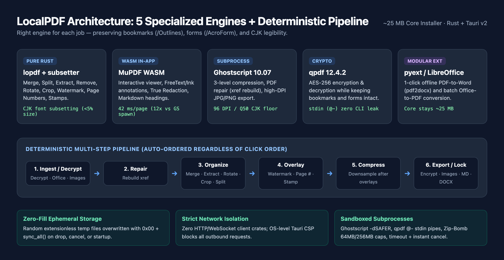
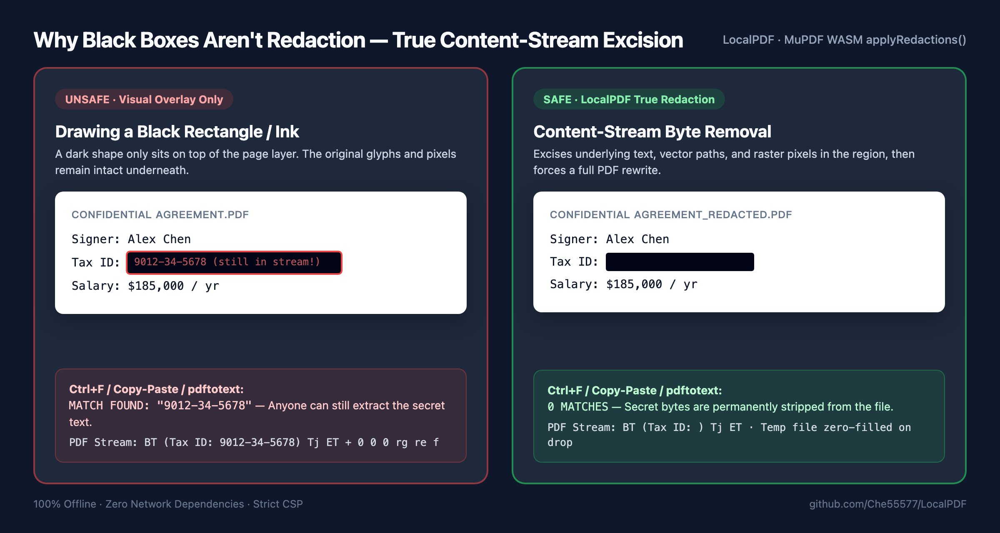

# LocalPDF

[](https://github.com/Che55577/LocalPDF/actions/workflows/ci.yml)
[](https://github.com/Che55577/LocalPDF/releases)
[](LICENSE)


**English** | [繁體中文](README.zh-TW.md)

> **Stop uploading contracts, IDs, payroll, and medical PDFs to random cloud websites.**  
> **LocalPDF** is a **~25 MB, 100% offline desktop PDF toolbox** built with **Rust, Tauri v2, and MuPDF WASM** — zero network dependencies, zero telemetry, true content-stream redaction, deterministic multi-step pipeline chaining, and a built-in headless CLI.

<p align="center">
  
</p>

---

## Why LocalPDF?

| Capability | Cloud PDF Sites<br>*(iLovePDF, Smallpdf)* | Browser WASM Tools<br>*(BentoPDF)* | Self-Hosted Docker<br>*(Stirling-PDF)* | **LocalPDF**<br>*(Native Desktop + CLI)* |
| :--- | :---: | :---: | :---: | :---: |
| **Files stay 100% on your machine** | ❌ Uploaded | ✅ In-browser | ✅ Self-hosted | ✅ **Native offline** |
| **Zero Docker / Server / Browser RAM limits** | ❌ | ⚠️ Tab RAM cap | ❌ Needs Docker/JVM | ✅ **~25 MB native app** |
| **Zero telemetry & strict CSP network lock** | ❌ | Depends on host | ⚠️ Config needed | ✅ **Zero HTTP crates** |
| **True content-stream redaction** | Paid / varies | Partial | Partial | ✅ **MuPDF stream excision** |
| **Zero-fill ephemeral file wiping** | ❌ | Browser GC | ❌ Standard temp | ✅ **`0x00` + `sync_all()`** |
| **Deterministic multi-step pipeline chaining** | ❌ | ❌ | Limited | ✅ **Auto-ordered batch** |
| **CJK font subsetting & legibility tuning** | ❌ | ⚠️ Heavy fonts | ⚠️ | ✅ **Empirically tuned** |
| **Built-in Headless CLI (no extra install)** | ❌ | ❌ | REST API only | ✅ **`localpdf` binary** |

---

## Key Highlights

### 1. True Content-Stream Redaction (Not Fake Black Boxes)
Drawing a black rectangle or ink stroke on top of a PDF leaves the underlying text bytes untouched — anyone can press `Ctrl+F` or copy-paste your secrets right out. LocalPDF calls MuPDF `applyRedactions()` to permanently strip text, vector paths, and raster pixels from the PDF content stream and forces a full rewrite.

<p align="center">
  
</p>

### 2. Empirically Tuned Compression (32 MB → 1.87 MB Without Blurry CJK Text)
Using [`bench/compress_bench.py`](bench/compress_bench.py) and [`bench/legibility_check.py`](bench/legibility_check.py), we measured Ghostscript presets across scanned PDFs, photo catalogs, and 100-page papers. Most tools blindly downsample to `72 DPI / Q40`, which turns CJK strokes illegible. LocalPDF sets its **Extreme** floor at `96 DPI / Q50` (5.8% file size, SSIM 0.908) and **Recommended** at `144 DPI / Q65` (11.3%, SSIM 0.944), fixing Ghostscript's `-dColorImageDownsampleThreshold=1.0` and `-dPassThroughJPEGImages=false` traps.

<p align="center">
  
</p>

### 3. Smart Multi-Step Pipeline Chaining
Select multiple operations at once (e.g., `Decrypt → Repair → Extract → Rotate → Watermark → Page Numbers → Compress → Encrypt`) and LocalPDF automatically executes them in canonical order—preserving bookmarks (`/Outlines`) and form fields (`/AcroForm`) via pure-Rust `lopdf`, subsetting CJK fonts via `subsetter` (<5% font overhead), and zero-filling intermediate temp files between stages.

### 4. Lightweight ~25 MB Core + Modular Offline `pyext`
The base installer bundles Ghostscript, `qpdf`, `lopdf`, and MuPDF WASM in ~25 MB. Need high-fidelity **PDF to Word (`.docx`)**? Import the standalone offline Python extension (`pyext`, powered by `pdf2docx` + CJK font remapping) with one click directly inside the app.

---

## 18-in-1 Feature Matrix

| Category | Tool | Description | Engine |
| :--- | :--- | :--- | :--- |
| **Compress & Repair** | **Compress PDF** | Three tuned presets (Extreme `96 DPI`, Recommended `144 DPI`, Low `300 DPI`) | Ghostscript (`pdfwrite`) |
| | **Repair PDF** | Rebuilds damaged cross-reference tables (`xref`) and broken object streams | Ghostscript |
| **Organize Pages** | **Merge PDF** | Combines PDFs in drag-and-drop order while preserving `/Outlines` and `/AcroForm` | `lopdf` (Pure Rust) |
| | **Split PDF** | Splits large PDFs by fixed page chunks or custom ranges | `lopdf` |
| | **Extract Pages** | Visual thumbnail organizer + range syntax (e.g., `1, 3, 5-10`) | `lopdf` |
| | **Remove Pages** | Deletes pages and prunes orphaned images (`prune_objects`) to genuinely shrink files | `lopdf` |
| | **Rotate Pages** | Rotates all or selected pages clockwise by 90°, 180°, or 270° | `lopdf` |
| | **Crop Margins** | Trims margins (`pt`/`mm`) with inherited `MediaBox` / `CropBox` handling | `lopdf` |
| **Convert Formats** | **PDF to Images** | Renders pages to high-resolution JPG or lossless PNG (20–600 DPI) | Ghostscript |
| | **Images to PDF** | Lossless direct `/DCTDecode` embedding for JPGs; alpha `/SMask` for PNGs | `lopdf` + `image` |
| | **PDF to Markdown** | Extracts structured text and infers `# / ## / ###` headings from font sizes | MuPDF WASM / GS |
| | **PDF to Word** | Reconstructs real paragraphs & tables into `.docx` with CJK font remapping | `pyext` (`pdf2docx`) |
| | **Office to PDF** | Batch-converts `.doc`/`.docx`, `.xls`/`.xlsx`, `.ppt`/`.pptx` offline | LibreOffice Headless |
| **Security & Redaction** | **Encrypt PDF** | AES-256 encryption; passwords passed over `stdin` (never visible in `ps`/Task Manager) | `qpdf` (`@-`) |
| | **Decrypt PDF** | Removes password protection with valid password for downstream pipelines | `qpdf` (`@-`) |
| | **True Redaction** | Strips text, vectors, and pixels from the PDF content stream + full rewrite | MuPDF WASM |
| **Annotate & Overlay** | **Watermark** | Angled text watermarks with automatic TrueType/CJK font subsetting | `lopdf` + `subsetter` |
| | **Page Numbers** | Customizable `{n} / {total}` templates across 9 grid positions | `lopdf` + `subsetter` |
| | **Stamp / Signature** | Overlays transparent PNG signatures or seals (`/SMask`) on target pages | `lopdf` + `/SMask` |
| | **Interactive Annotate** | 42 ms/page interactive viewer with FreeText, freehand ink, and true redaction | MuPDF WASM |

---

## Download & Installation

Grab the latest pre-built installer from [**GitHub Releases**](https://github.com/Che55577/LocalPDF/releases):

| OS | Package | Notes |
| :--- | :--- | :--- |
| **Windows (x64)** | `LocalPDF_*_x64-setup.exe` | NSIS installer (bundles Ghostscript + `qpdf` out of the box) |
| **macOS (Apple Silicon)** | `LocalPDF_*_aarch64.dmg` | Drag `LocalPDF.app` to `Applications` |
| **Linux (Ubuntu / Debian)** | `LocalPDF_*_amd64.deb` / `.AppImage` | `sudo apt install ./LocalPDF_*_amd64.deb` (uses system `ghostscript` & `qpdf`) |

<details>
<summary><b>First-Launch Guide for Unsigned Builds & Sigstore Provenance Verification</b></summary>

LocalPDF is an independent open-source project without paid Apple Developer ID / Windows EV code-signing certificates yet, so your OS may show an unsigned binary prompt on first launch:

* **macOS ("LocalPDF is damaged and can't be opened" / unidentified developer)**:
  After dragging `LocalPDF.app` to `/Applications`, clear the browser quarantine attribute in Terminal:
  ```bash
  xattr -cr /Applications/LocalPDF.app
  ```
* **Windows (SmartScreen prompt)**:
  Click **"More info"** → **"Run anyway"**.
* **Verify Cryptographic Build Provenance (`SHA256SUMS.txt` + Sigstore)**:
  Every release includes `SHA256SUMS.txt` and a Sigstore build provenance attestation generated by GitHub Actions:
  ```bash
  gh attestation verify <downloaded-installer-file> --repo Che55577/LocalPDF
  ```
</details>

<details>
<summary><b>Enabling Optional Offline Extensions (PDF to Word & Office to PDF)</b></summary>

1. **Enable "PDF to Word" (`pyext`)**:
   - Download `localpdf-pyext-<Platform>.zip` from [GitHub Releases](https://github.com/Che55577/LocalPDF/releases).
   - Open LocalPDF → click **"Import Extension (.zip)"** in the footer or inside the "PDF to Word" panel → select the `.zip` file (no admin privileges or restart needed; works 100% offline).
2. **Enable "Office to PDF" (LibreOffice)**:
   - LocalPDF auto-detects installed LibreOffice:
     ```bash
     # Windows (winget)
     winget install --id TheDocumentFoundation.LibreOffice -e
     # macOS (Homebrew)
     brew install --cask libreoffice
     # Ubuntu / Debian
     sudo apt-get install -y libreoffice
     ```
</details>

---

## Privacy & Security Architecture

LocalPDF is engineered under a strict threat model: **assume every file is confidential and every untrusted input PDF may be malformed**.

1. **Three-Tier Ephemeral File Wiping**:
   - **Isolated Volatile Directory**: Intermediate files use random extensionless names inside a controlled temp directory so OS thumbnailers and search indexers skip them.
   - **Zero-Fill on Drop**: On success, error, cancellation, or panic, the `Ephemeral` RAII guard overwrites temp bytes with `0x00` and calls `sync_all()` before unlinking.
   - **Startup Sweep**: Every launch sweeps leftover temp artifacts from prior crashes or power loss.
2. **Process-Table Safe Passwords**:
   - Calls `qpdf @-` via anonymous `stdin` pipes—passwords never appear in `ps` or Task Manager command lines.
3. **Subprocess Sandboxing & Zip-Bomb Guards**:
   - Ghostscript always runs with `-dSAFER`; `.docx` font remapping enforces 64 MB per-entry and 256 MB total extraction caps; subprocesses run under timeout and dual-thread pipe draining with instant cancellation.

> **Hardware Reality Check**: On modern SSDs, wear-leveling and TRIM mean software zero-filling cannot guarantee immediate physical flash cell erasure. For protection against physical disk forensics, pair LocalPDF with full-disk encryption (BitLocker, FileVault, or LUKS).

---

## Headless CLI Mode

Automate PDF workflows in shell scripts or CI pipelines with the same `localpdf` binary:

```bash
localpdf --help

# Extract and reorder pages (page 3 first, then pages 1-2)
localpdf extract contract.pdf --pages 3,1-2 -o reordered.pdf

# Merge PDFs while preserving bookmarks, links, and form fields
localpdf merge part1.pdf part2.pdf -o combined.pdf

# Compress PDF (extreme | recommended | low)
localpdf compress report.pdf --level recommended -o report_small.pdf

# AES-256 encrypt & decrypt
localpdf encrypt secret.pdf --user-pw "MyPass123" -o encrypted.pdf
localpdf decrypt encrypted.pdf --password "MyPass123" -o unlocked.pdf
```

---

## FAQ

<details>
<summary><b>Q1: Can I directly edit existing body paragraphs inside a PDF?</b></summary>

PDF files store positioned glyph runs at absolute coordinates rather than reflowable paragraphs.
- **For notes, signatures, form filling, or hiding secrets**: use the built-in **Annotate** editor (FreeText, ink, stamps, and true redaction).
- **For rewriting body text with automatic paragraph reflow**: convert **PDF to Word** (`.docx`) → edit in Word or LibreOffice Writer → convert back with **Office to PDF**. LocalPDF provides both ends offline.
</details>

<details>
<summary><b>Q2: Why is "PDF to Word" a separate extension pack?</b></summary>

High-fidelity PDF-to-Word reconstruction relies on `pdf2docx`, `PyMuPDF`, and `OpenCV` (~216 MB even after stripping). Keeping it as a one-click optional import keeps the core installer down to **~25 MB** for everyone else while staying 100% offline.
</details>

---

## Build from Source & Benchmarks

See [**`docs/ARCHITECTURE.md`**](docs/ARCHITECTURE.md) for deep technical details and [`bench/`](bench/) for reproducible benchmark scripts.

```bash
# 1. Install frontend deps (auto-syncs MuPDF WASM into public/mupdf/)
npm ci

# 2. Fetch or build vendored Ghostscript & qpdf (SHA-256 verified)
npm run fetch:vendor

# 3. Run UI integration tests & frontend build
npm run test:ui
npm run build

# 4. Generate test corpus & run Rust tests
pip install reportlab pillow
python bench/make_corpus.py
cargo test --manifest-path src-tauri/Cargo.toml

# 5. Launch desktop dev mode
npm run tauri dev
```

Contributions are welcome! Please read [**CONTRIBUTING.md**](CONTRIBUTING.md) and [**SECURITY.md**](SECURITY.md).

---

## License

Licensed under [**GNU Affero General Public License v3.0 or later (AGPL-3.0-or-later)**](LICENSE). See [**THIRD_PARTY_NOTICES.md**](THIRD_PARTY_NOTICES.md) for bundled open-source components.

If LocalPDF helps keep your confidential documents off third-party servers, consider giving the repo a **Star ⭐️**!
