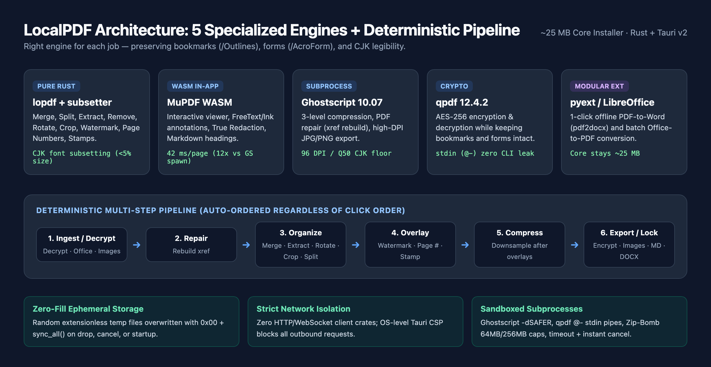
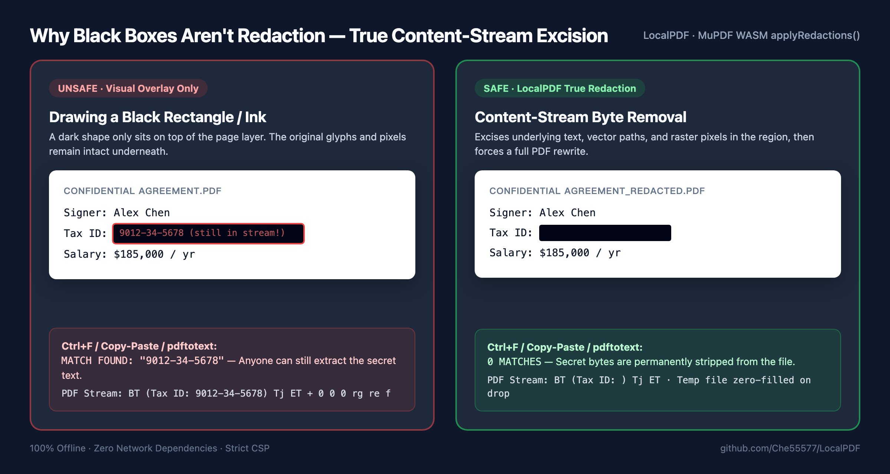

# LocalPDF

[](https://github.com/Che55577/LocalPDF/actions/workflows/ci.yml)
[](https://github.com/Che55577/LocalPDF/releases)
[](LICENSE)


[English](README.md) | **繁體中文**

> **別再把合約、身分證、薪資單與病歷上傳到免費線上 PDF 網站了。**  
> **LocalPDF** 是一款僅約 **25 MB、100% 本機離線運作的跨平台 PDF 工具箱**（Rust + Tauri v2 + MuPDF WASM）——零網路依賴、零遙測、底層串流真塗黑、確定性多工管線串接，並內建 Headless CLI 命令列模式。

<p align="center">
  
</p>

---

## 為什麼選擇 LocalPDF？

| 比較項目 | 線上 PDF 網站<br>*(iLovePDF / Smallpdf)* | 瀏覽器 WASM 工具<br>*(BentoPDF)* | Docker 自架服務<br>*(Stirling-PDF)* | **LocalPDF**<br>*(原生桌面＋CLI)* |
| :--- | :---: | :---: | :---: | :---: |
| **檔案 100% 留在本機** | ❌ 需上傳伺服器 | ✅ 瀏覽器內處理 | ✅ 自架端處理 | ✅ **原生離線處理** |
| **免 Docker／免開瀏覽器記憶體上限** | ❌ | ⚠️ 受限分頁記憶體 | ❌ 需裝 Docker/JVM | ✅ **僅 ~25 MB 原生執行檔** |
| **零遙測＋CSP 鎖死外部連線** | ❌ | 視託管環境而定 | ⚠️ 需手動關閉設定 | ✅ **零 HTTP 相依** |
| **底層內容串流真塗黑（True Redaction）** | 多為付費／不一 | 部分支援 | 部分支援 | ✅ **MuPDF 底層抹除＋重寫** |
| **暫存檔即時覆寫抹除（Zero-Fill）** | ❌ | 依賴瀏覽器 GC | ❌ 一般暫存檔 | ✅ **`0x00` 覆寫＋`sync_all()`** |
| **多工管線確定性自動排序串接** | ❌ | ❌ | 有限 | ✅ **一次勾選自動最佳排序** |
| **繁體中文字型子集化與筆畫清晰實測** | ❌ | ⚠️ 易爆體積 | ⚠️ | ✅ **專為繁中實測調校** |
| **內建 Headless CLI 自動化批次** | ❌ | ❌ | 僅 REST API | ✅ **同執行檔支援 CLI** |

---

## 核心亮點

### 1. 內容串流真塗黑（True Redaction）——杜絕「假黑框」資安風險
用一般 PDF 閱讀器的畫筆或黑色矩形蓋住身分證字號、帳號或金額，只是在頁面上疊了一層圖形——底下的原始文字位元組依然完整留在檔案裡，任何人按 `Ctrl+F` 或複製貼上就能讀出原文。LocalPDF 直接呼叫 MuPDF `applyRedactions()` 從底層內容串流徹底移除文字、向量路徑與點陣像素，並強制完整重寫檔案。

<p align="center">
  
</p>

### 2. 專為繁體中文調校的實測壓縮（32 MB → 1.87 MB 依然清晰不糊字）
透過 [`bench/compress_bench.py`](bench/compress_bench.py) 與 [`bench/legibility_check.py`](bench/legibility_check.py) 實測多類 PDF 語料：常見工具預設降採樣至 `72 DPI / Q40` 會讓繁體中文筆畫嚴重黏連。LocalPDF 將**極限壓縮**下限定在 `96 DPI / Q50`（體積降至 5.8%、SSIM 0.908）、**建議壓縮**定在 `144 DPI / Q65`（11.3%、SSIM 0.944），並修正 Ghostscript `-dColorImageDownsampleThreshold=1.0` 與 `-dPassThroughJPEGImages=false` 兩大預設陷阱。

<p align="center">
  
</p>

### 3. 智慧多工管線串接（Pipeline Chaining）
可同時勾選多項操作（例如：`解密 → 修復 → 擷取 → 旋轉 → 加浮水印 → 加頁碼 → 壓縮 → 加密`），系統會依最佳確定性順序一次完成：純 Rust `lopdf` 保留書籤（`/Outlines`）與表單（`/AcroForm`）、`subsetter` 自動對中文字型子集化（避免嵌入 20 MB 完整字型）、並在各階段完成後即時以 `0x00` 覆寫刪除中間暫存檔。

### 4. ~25 MB 輕量主程式 + 選用離線擴充包（`pyext`）
主安裝檔內建 Ghostscript、`qpdf`、`lopdf` 與 MuPDF WASM 僅約 25 MB。需要高還原度 **PDF 轉 Word（`.docx`）** 時，可於軟體內一鍵匯入獨立離線擴充包（`pyext`，含 `pdf2docx` 與中文字型校正）。

---

## 功能總覽（18 項工具）

| 類別 | 工具名稱 | 功能說明 | 底層技術引擎 |
| :--- | :--- | :--- | :--- |
| **壓縮與修復** | **壓縮 PDF** | 提供極限（96 DPI）、建議（144 DPI）、低度（300 DPI）三段實測調校 | Ghostscript (`pdfwrite`) |
| | **修復 PDF** | 重建損毀的交叉參照表（`xref`）與物件串流，救回無法開啟的 PDF | Ghostscript |
| **頁面整理** | **合併 PDF** | 依拖曳順序合併多份 PDF，保留書籤（`/Outlines`）與表單欄位（`/AcroForm`） | `lopdf`（純 Rust） |
| | **分割 PDF** | 依固定頁數或自訂頁碼區間，將長篇 PDF 拆分為多個獨立檔案 | `lopdf` |
| | **擷取頁面** | 支援視覺化縮圖排版器與 `1, 3, 5-10` 語法，精準抽出並重排頁面 | `lopdf` |
| | **移除頁面** | 刪除指定頁碼並清除孤兒影像物件（`prune_objects`），確實縮減體積 | `lopdf` |
| | **旋轉頁面** | 支援全文件或指定頁面順時針 90° / 180° / 270° 旋轉 | `lopdf` |
| | **裁切白邊** | 自訂上下左右邊界，支援繼承式 `MediaBox` / `CropBox` 精準裁切 | `lopdf` |
| **格式轉換** | **PDF 轉圖片** | 將每一頁輸出為高解析度 JPG 或無損 PNG（20–600 DPI） | Ghostscript |
| | **圖片轉 PDF** | JPG 原生 `/DCTDecode` 無損直嵌（零重編碼）；PNG 保留透明通道（`/SMask`） | `lopdf` + `image` |
| | **PDF 轉 Markdown** | 依據字級與段落結構自動推斷 `# / ## / ###` 標題層級並匯出 `.md` | MuPDF WASM / GS |
| | **PDF 轉 Word** | 重建真實段落與表格為 `.docx`（保留條碼／QR 碼並自動校正中文字型） | `pyext` (`pdf2docx`) |
| | **Office 轉 PDF** | 支援 Word、Excel、PowerPoint 批次離線轉為 PDF | LibreOffice Headless |
| **安全與遮蔽** | **加密 PDF** | 以 AES-256 加密，密碼透過 `stdin` 傳遞、絕不暴露於系統行程清單 | `qpdf` (`@-`) |
| | **解密 PDF** | 輸入正確密碼後移除 PDF 密碼保護，方便後續歸檔或串接處理 | `qpdf` (`@-`) |
| | **真塗黑（Redact）** | 於預覽畫布框選敏感區域，存檔時徹底從 PDF 串流抹除該處文字與影像 | MuPDF WASM |
| **標註與疊加** | **加浮水印** | 支援角度、字級、顏色與透明度自訂，並自動對中文字型子集化 | `lopdf` + `subsetter` |
| | **加頁碼** | 支援九宮格位置、起始頁碼與 `{n} / {total}` 格式樣板 | `lopdf` + `subsetter` |
| | **蓋圖章／簽名** | 將透明背景 PNG 簽名檔或公司章（`/SMask`）疊加至指定角落與頁面 | `lopdf` + `/SMask` |
| | **互動式註記** | 42 ms/頁翻頁預覽、自由文字標註（FreeText）、手繪筆跡（Ink）與真塗黑 | MuPDF WASM |

---

## 下載與安裝

請前往 [**GitHub Releases**](https://github.com/Che55577/LocalPDF/releases) 下載對應作業系統的最新安裝檔：

| 作業系統 | 下載檔案格式 | 安裝說明 |
| :--- | :--- | :--- |
| **Windows (x64)** | `LocalPDF_*_x64-setup.exe` | 執行安裝程式即可（內含 Ghostscript 與 `qpdf`） |
| **macOS (Apple Silicon)** | `LocalPDF_*_aarch64.dmg` | 拖入 `Applications` 資料夾 |
| **Linux (Ubuntu / Debian)** | `LocalPDF_*_amd64.deb` / `.AppImage` | `sudo apt install ./LocalPDF_*_amd64.deb`（搭配系統 `ghostscript` 與 `qpdf`） |

<details>
<summary><b>首次啟動安全提示（Gatekeeper / SmartScreen）與 Sigstore 產物來源驗證</b></summary>

由於本專案為獨立開源專案，尚未購買商業憑證機構（Apple Developer ID / Windows EV）簽章，首次開啟時作業系統會顯示未簽章提示：

* **macOS（「LocalPDF 已損毀，無法打開」或「無法驗證開發者」）**：
  將 `LocalPDF.app` 拖入 `/Applications` 後，於終端機執行以下指令移除瀏覽器下載附加的隔離屬性即可：
  ```bash
  xattr -cr /Applications/LocalPDF.app
  ```
* **Windows（「Windows 已保護您的電腦」SmartScreen 提示）**：
  點擊 **「其他資訊（More info）」** → **「仍要執行（Run anyway）」**。
* **驗證發佈產物完整性與 GitHub 官方建置來源（Provenance Attestation）**：
  每個 Release 皆附帶 `SHA256SUMS.txt` 與 GitHub Actions 產生的 Sigstore 建置證明：
  ```bash
  gh attestation verify <下載的安裝包檔名> --repo Che55577/LocalPDF
  ```
</details>

<details>
<summary><b>啟用選用擴充功能（PDF 轉 Word 與 Office 轉 PDF）</b></summary>

1. **啟用「PDF 轉 Word」（Python 離線擴充包 `pyext`）**：
   - 於 [GitHub Releases](https://github.com/Che55577/LocalPDF/releases) 下載對應平台的 `localpdf-pyext-*.zip`。
   - 開啟 LocalPDF，點擊頁尾或「PDF 轉 Word」面板中的 **「匯入擴充包 (.zip)」** 即可一鍵驗證並啟用（免管理員權限、免重啟、100% 離線）。
2. **啟用「Office 轉 PDF」（LibreOffice）**：
   - LocalPDF 會自動偵測系統已安裝的 LibreOffice。若尚未安裝：
     ```bash
     # Windows (PowerShell)
     winget install --id TheDocumentFoundation.LibreOffice -e
     # macOS (Homebrew)
     brew install --cask libreoffice
     # Ubuntu / Debian
     sudo apt-get install -y libreoffice
     ```
</details>

---

## 隱私與安全保障機制

LocalPDF 的核心設計原則是**「假設所有處理的文件皆為最高機密，且所有外部輸入檔案皆可能包含惡意構造」**：

1. **三道暫存檔抹除防線**：
   - **受控隔離目錄**：所有中間檔僅寫入專屬暫存目錄（亂數檔名、無副檔名，防止作業系統縮圖或搜尋索引服務偷讀）。
   - **即時覆寫刪除（Zero-Fill on Drop）**：無論作業成功、失敗、使用者中途取消或程式發生異常，`Ephemeral` 控制器與 `wipe_dir_all` 皆會先將檔案位元組覆寫為 `0x00` 並強制刷入磁碟（`sync_all`）後才刪除檔案。
   - **啟動自動掃除**：每次啟動 App 時，第一時間自動清掃暫存根目錄，確保即使前次因斷電或強制結束行程也不留殘骸。
2. **密碼零暴露（Process-Table Safe）**：
   - 加解密呼叫 `qpdf @-`，所有參數與密碼皆透過匿名管道（`stdin`）傳入並立即關閉串流，其他行程絕對無法從命令列參數偷看到密碼。
3. **子行程沙箱與防死鎖保護**：
   - Ghostscript 全程強制附加 `-dSAFER` 封鎖 PostScript 檔案系統存取；`.docx` 字型修正具備 64 MB 單檔與 256 MB 總量之 ZIP 炸彈（Zip Bomb）防護；所有子行程皆具備逾時強殺、雙背景執行緒管道排空與即時取消機制。

> **硬體層誠實聲明**：在現代 SSD 與快閃記憶體上，由於硬體控制器的磨損平衡（Wear-Leveling）與 TRIM 機制，軟體層的零覆寫無法保證實體快閃記憶體區塊立即抹除。若你的威脅模型包含實體硬碟鑑識，請務必搭配作業系統全磁碟加密（Windows BitLocker / macOS FileVault / Linux LUKS）。

---

## Headless CLI 命令列批次模式

除了桌面圖形介面外，`localpdf` 執行檔亦內建 **Headless CLI 模式**，方便在 Shell 腳本或 CI/CD 管線中批次自動化處理 PDF：

```bash
localpdf --help

# 依指定順序擷取並重排頁面（第 3 頁排最前，接著第 1–2 頁）
localpdf extract contract.pdf --pages 3,1-2 -o reordered.pdf

# 合併多份 PDF（保留書籤、連結與表單欄位）
localpdf merge part1.pdf part2.pdf -o combined.pdf

# 壓縮 PDF（extreme | recommended | low）
localpdf compress report.pdf --level recommended -o report_small.pdf

# AES-256 加密與解密
localpdf encrypt secret.pdf --user-pw "MyPass123" -o encrypted.pdf
localpdf decrypt encrypted.pdf --password "MyPass123" -o unlocked.pdf
```

---

## 常見問題（FAQ）

<details>
<summary><b>Q1：我可以直接修改 PDF 裡既有的段落文字嗎？</b></summary>

PDF 格式本質上是「帶有絕對座標的字元繪製指令」，檔案內並沒有「段落」或「自動換行欄寬」的資訊。因此：
- 若只需**補充說明、填表、簽名或遮蔽敏感文字**：請直接使用內建的 **「註記」** 工具（提供文字標註、手繪、圖章與真塗黑）。
- 若需要**大幅修改內文並讓段落自動重新排版**：唯一可靠的方式是使用 **「PDF 轉 Word」** 轉為 `.docx` → 在 Word 或 LibreOffice Writer 中編輯 → 再用 **「Office 轉 PDF」** 轉回 PDF。LocalPDF 同時提供這兩端的離線轉換工具。
</details>

<details>
<summary><b>Q2：為什麼「PDF 轉 Word」要做成獨立擴充包，而不直接包進主程式？</b></summary>

高品質的 PDF 轉 Word 需要依賴 Python 生態系的 `pdf2docx`、`PyMuPDF` 與 `OpenCV`（經過瘦身後仍約 216 MB）。將其拆分為一次性匯入的選用擴充包，可讓大多數只需要壓縮、合併、加解密與註記的使用者享受僅 **25 MB** 的輕量安裝包，安裝後同樣 **100% 離線運作**。
</details>

---

## 從原始碼建置與開發

完整的技術架構、引擎分工與實測基準數據，請參閱 [**`docs/ARCHITECTURE.md`**](docs/ARCHITECTURE.md)。

```bash
# 1. 安裝前端相依套件（自動同步 MuPDF WASM 至 public/mupdf/）
npm ci

# 2. 下載或編譯外部二進位引擎（含 SHA-256 雜湊校驗）
npm run fetch:vendor

# 3. 執行前端 UI 自動化測試與建置檢查
npm run test:ui
npm run build

# 4. 產生整合測試語料庫並執行 Rust 測試
pip install reportlab pillow
python bench/make_corpus.py
cargo test --manifest-path src-tauri/Cargo.toml

# 5. 啟動桌面開發模式
npm run tauri dev
```

歡迎提交 Issue 與 Pull Request！參與開發前請先閱讀 [**貢獻指南 (CONTRIBUTING.md)**](CONTRIBUTING.md) 與 [**安全政策 (SECURITY.md)**](SECURITY.md)。

---

## 授權條款

本專案採用 [**GNU Affero General Public License v3.0 or later (AGPL-3.0-or-later)**](LICENSE) 授權釋出。隨附之第三方開源元件與二進位引擎授權聲明請見 [**THIRD_PARTY_NOTICES.md**](THIRD_PARTY_NOTICES.md)。

如果 LocalPDF 幫你省下了把機密文件上傳到未知網站的風險，歡迎點擊右上角 **Star ⭐️** 支持！
